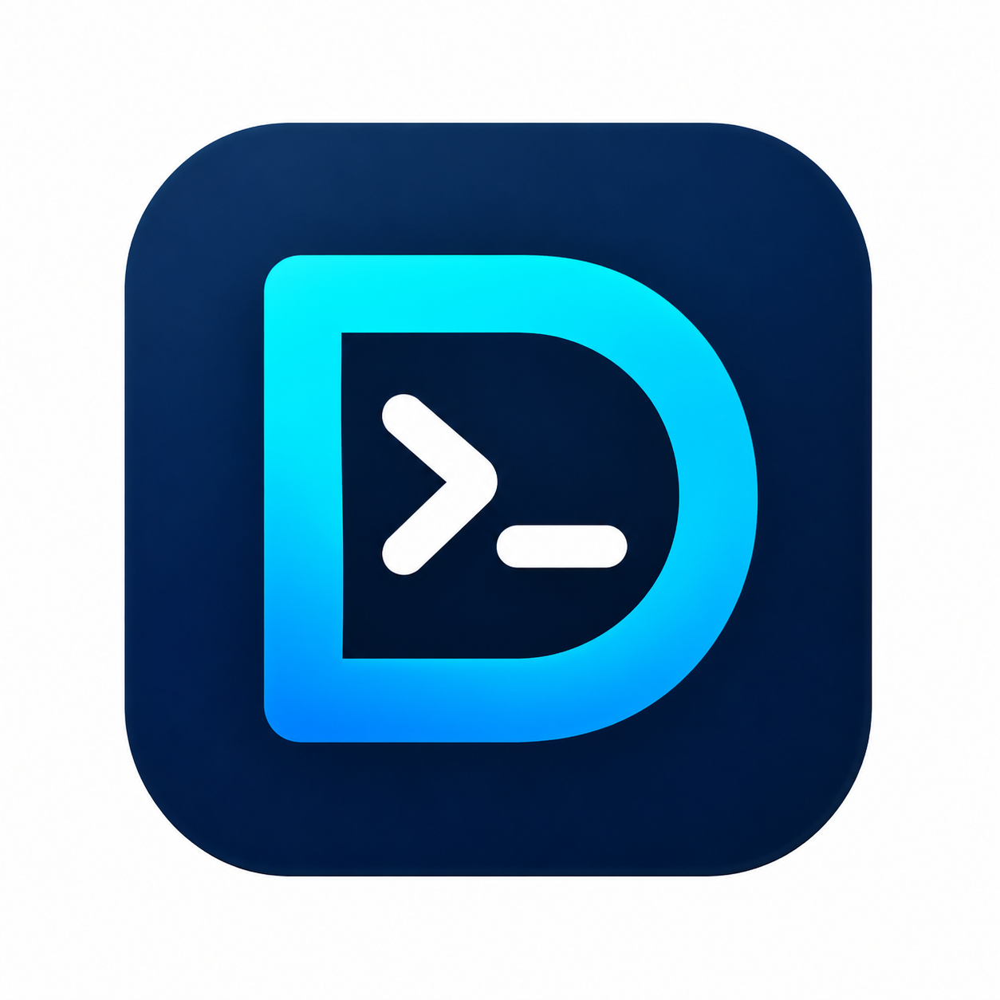
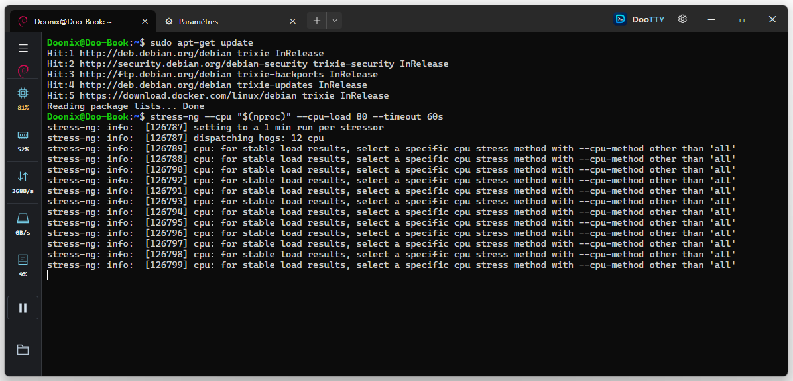

  

<h1 align="center">DooTTY</h1>

<strong>Your native WSL client.</strong>

  
  
  
  
  

DooTTY est une application Windows dédiée à vos distributions **WSL**.
Elle rassemble vos terminaux Linux, le suivi des ressources et les outils de
gestion WSL dans une interface sobre, inspirée de Windows Terminal.

Le projet est né d’un besoin simple : disposer d’une fenêtre dédiée à son
environnement Linux sous Windows, avec ses distributions et ses outils au même endroit.

## Fonctionnalités

- **Vos distributions en onglets** : plusieurs terminaux indépendants, icônes
  Linux, choix rapide de distribution et profils de lancement conservés par onglet.
- **Un terminal confortable** : copier/coller Windows ↔ Linux, recherche, zoom,
  sélection rectangulaire et raccourcis clavier pour les actions courantes.
- **Les ressources à portée de vue** : volet repliable suivant l’onglet actif,
  CPU, mémoire, réseau, activité disque, espace libre et graphes d’historique.
  Les couleurs signalent les fortes charges ; un raccourci ouvre le dossier du profil.
- **WSL sous contrôle** : état des distributions, arrêt et redémarrage ciblés,
  version installée, recherche de mises à jour et accès aux notes de version GitHub.
- **Des réglages réunis** : accès à WSL Settings, au fichier de configuration
  WSL et à l’emplacement des disques VHDX depuis l’application.
- **Installation et sauvegarde — Bêta** : catalogue des distributions,
  installation, export et import de sauvegardes.
- **Une interface à votre goût** : français ou anglais, polices à chasse fixe,
  taille du texte, curseur et cinq jeux de couleurs.
- **Vos préférences conservées** : réglages centralisés, enregistrement explicite
  et restauration à la réouverture, avec confirmation avant de fermer plusieurs onglets.

## Démarrer

Copiez `DooTTY.exe` dans un dossier Windows puis lancez-le. Prérequis :
**Windows 11 x64**, **WSL**, une distribution Linux et **Microsoft WebView2**.
Aucun outil de développement n’est nécessaire pour l’utiliser.

La version actuelle est livrée sans installateur et conserve ses préférences
dans le profil Windows. Voir les [options de distribution](docs/distribution.md)
pour l’installation et le mode portable envisagés.

## Documentation et contribution

- [Guide d’utilisation](docs/utilisation.md) : réglages, monitoring, gestion WSL et raccourcis.
- [Développement et compilation](docs/developpement.md).
- [Traductions communautaires](TRANSLATING.md).
- [Validation et essais](docs/validation.md).
- [Changements](CHANGELOG.md).

Projet maintenu par [DooSys](https://github.com/DooSys).
Les retours et contributions sont les bienvenus sur [GitHub](https://github.com/DooSys/DooTTY).

## Licence

DooTTY est distribué sous [licence MIT](LICENSE), copyright 2026 DooSys.
Les composants tiers et les logos conservent leurs licences respectives :
[composants et attributions](THIRD_PARTY.md).
