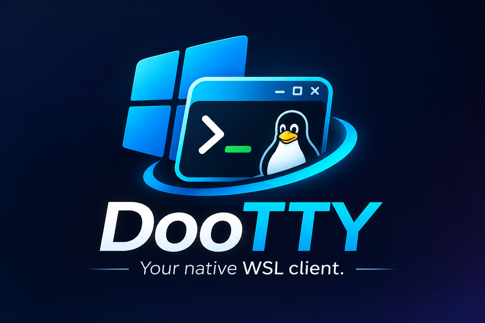

# Utiliser DooTTY



Ce guide regroupe les réglages et les commandes de l’interface. Pour une vue
d’ensemble, consultez la [présentation du projet](../README.md).

## Utilisation

Lancez `DooTTY-<version>-setup.exe` et choisissez **Installer pour moi** ou
**Portable**. Le premier mode ajoute un raccourci Démarrer et une entrée de
désinstallation Windows. Le second demande simplement un dossier accessible
en écriture et y réunit l’application, ses licences et ses données dans `data`.
Prérequis : Windows 11 x64, WSL, une distribution Linux et Microsoft WebView2.
Voir les [modes de distribution](distribution.md).

Le binaire n'est pas signé. Un avertissement SmartScreen peut apparaître ; un
lancement depuis un partage UNC peut aussi produire un avertissement d'ouverture.
Utiliser un dossier Windows local permet de distinguer l'effet de l'emplacement.

## Réglages et réouverture

Les préférences sont enregistrées après **Enregistrer**. En mode installé :

```text
%APPDATA%\DooTTY\config.json
```

En mode portable : `data\config.json`, à côté de `DooTTY.exe`. Le cache
WebView2 est lui aussi dans `data`. Conservez ce dossier lors des mises à jour.

Au lancement, ce fichier est lu et validé avant la création du premier terminal.
La langue, le profil, l'apparence, le monitoring et les options d'interaction sont
restaurés. L'exemple [config.example.json](../config.example.json) contient les valeurs
initiales. Les anciennes configurations reçoivent les valeurs par défaut des
champs ajoutés. Une configuration invalide reste intacte et une erreur est affichée.

La sauvegarde écrit un fichier temporaire synchronisé avant de remplacer l'ancien.
Une erreur de sauvegarde ne doit pas détruire les préférences précédentes.
Les onglets ouverts, leur sortie, la pause du monitoring et son historique ne sont
pas enregistrés. Le profil WebView2 est géré séparément dans le dossier local de
l'application Windows ; les préférences DooTTY ne dépendent pas du cache de la WebView.

## Profils et actions du terminal

Dans **Général → Profils enregistrés**, ajoutez ou modifiez un nom, une distribution,
un utilisateur Linux facultatif et un répertoire de départ. Validez le dialogue,
puis **Enregistrer** pour conserver les changements. Le profil d’ouverture est utilisé
au lancement et avec **+** ; « Session personnalisée » utilise les champs précédents.
Les profils sont aussi proposés dans le menu de la flèche et la palette de commandes.
Supprimer un profil n’efface pas sa distribution ni les onglets déjà ouverts.

Le clic droit sur un onglet propose **Renommer**, **Dupliquer** et **Fermer les autres
onglets**. La duplication crée une nouvelle session avec le même profil de départ ;
elle ne reprend ni les processus ni les changements de dossier effectués dans le shell.
Un nom vide réactive le titre automatique. La fermeture des autres terminaux est
confirmée lorsque l’avertissement de fermeture est actif ; l’onglet Paramètres reste ouvert.

**Ctrl+Maj+P** ouvre la palette : recherchez une action ou un profil, utilisez les
flèches et Entrée pour choisir, ou Échap pour revenir au terminal.

**Effacer l’historique** supprime les lignes sorties de l’écran, en conservant l’écran
courant et la position du curseur pour rester synchronisé avec ConPTY. Les commandes
en cours ne sont pas interrompues. Cette action est indisponible dans l’écran alternatif d’une application plein écran.
**Exporter le texte** enregistre le buffer actif dans un fichier `.txt` UTF-8 choisi avec
la boîte Windows « Enregistrer sous ». Seul le texte encore conservé est disponible ;
les lignes simplement repliées sont réunies. Au-delà de 8 Mio, l’export est refusé sans
troncature. Le fichier est remplacé après écriture complète, avec confirmation Windows
si le nom existe déjà.

**Général → Confirmer le collage multiligne**, désactivé initialement, ouvre un éditeur
lorsque le texte préparé contient un retour à la ligne, y compris à la fin. Annuler
n’envoie rien ; **Coller** envoie le texte modifié. Entrée ajoute une ligne dans l’éditeur
sans valider l’envoi. Le texte complet est affiché, dans la limite de 4 Mio du collage.
Une confirmation n’est plus valable si sa session a été fermée ou remplacée.

La **lecture seule**, activée par onglet via son menu ou la palette, bloque la saisie
et les collages. Le flux de sortie, la sélection, la copie et l’export restent utilisables.
Le cadenas identifie l’onglet protégé. Ce mode ne modifie pas les droits des fichiers Linux.
Les noms personnalisés des onglets et leur lecture seule restent propres à l’ouverture courante.

## Monitoring

Activé par défaut, il se désactive dans **Général → Activer le monitoring WSL**.
Le choix est enregistré. Le rail compact fait 56 px et se déplie par le bouton à
trois barres. Les pourcentages passent en orange à 75 % et en rouge à 90 %.

Une sonde Linux fixe est pilotée par Rust, sans installer d'agent ni demander
l'élévation. Une seule collecte est active ; la prochaine démarre deux secondes
après la précédente. Les lectures sont suspendues dans les paramètres, quand le
document est masqué, en pause ou sans session connectée. Une lecture déjà en cours
peut encore se terminer. L'historique reste en mémoire, borné à cinq minutes par profil.

Sous WSL2, **CPU, mémoire et réseau sont partagés entre distributions**. Les volumes
et E/S du disque racine correspondent à l'espace de montage de la distribution.
Le monitoring n'attribue pas ces ressources à ses seuls processus et ne surveille
pas les machines SSH distantes. L'utilisateur affiché est celui du profil de lancement.

Le bouton de dossier ouvre le répertoire de lancement du profil, résolu dans Linux,
via l'Explorateur Windows. Il ne suit pas les changements de répertoire faits ensuite
à l'intérieur du shell.

## Gestion WSL

Les commandes passent directement par le `wsl.exe` système, avec arguments séparés,
sans PowerShell ni CMD. Les actions modificatrices demandent confirmation et une
seule opération de gestion peut s'exécuter à la fois.

Le premier accès aux paramètres vérifie la version installée, la configuration
actuelle et la dernière publication stable Microsoft WSL sur GitHub. Les résultats
restent en mémoire jusqu'à la fermeture de DooTTY. L'icône de synchronisation
force une nouvelle lecture ; l'icône GitHub ouvre les notes du tag stable.
Il n'y a aucune recherche de version au lancement de l'application.

La mise à jour n'est proposée qu'après comparaison avec une version stable plus
récente. Elle lance `wsl.exe --update --web-download` après confirmation. En cas
d'échec, une reprise administrateur explicite peut déclencher l'UAC pour cette
seule commande fixe ; DooTTY et ses terminaux gardent leurs droits habituels.

**Relancer WSL** lance `wsl.exe --shutdown`, puis redémarre les distributions
qui étaient actives. S’il n’y en avait aucune, seule la distribution par défaut
est démarrée. Les terminaux DooTTY qui étaient ouverts sont reconnectés ; les
commandes qui y tournaient ne sont pas reprises. **Redémarrer** sur une distribution
réalise un arrêt ciblé puis relance ses terminaux DooTTY. Ces opérations interrompent
les sessions et services concernés, y compris ceux d’autres applications.
Les sondes sont coordonnées avec les arrêts internes et vérifient l'état courant
avant de démarrer. Un arrêt lancé à l'extérieur n'utilise pas ce verrou ; les
courses entre applications et les relances par d'autres clients restent à tester
sur le poste. Fermer un onglet ferme sa session, sans arrêt global de WSL.

Les exports refusent les fichiers existants. Les imports exigent un nouveau nom
et un nouveau dossier. Aucun effacement de distribution n'est exposé. Les chemins
d'import/export sont des chemins Windows absolus sur un disque local.

## Raccourcis

| Action | Raccourci |
|---|---|
| Nouvel onglet / fermer l'onglet | Ctrl+Maj+T / Ctrl+Maj+W |
| Onglet suivant / précédent | Ctrl+Tab / Ctrl+Maj+Tab |
| Paramètres | Ctrl+, |
| Palette de commandes | Ctrl+Maj+P |
| Copier / coller | Ctrl+Maj+C / Ctrl+Maj+V |
| Coller | Maj+Inser |
| Tout sélectionner | Ctrl+Maj+A |
| Rechercher | Ctrl+Maj+F |
| Ouvrir un lien HTTP(S) dans le navigateur par défaut | Ctrl+clic |
| Zoom / réduire / réinitialiser | Ctrl+Plus / Ctrl+Moins / Ctrl+0 |

Ctrl+C, Ctrl+D, Ctrl+Z et AltGr restent transmis au terminal. Dans les applications
qui demandent la souris, Maj permet de forcer la sélection locale ou le collage au clic droit.

## Thème de l’application

Le bouton soleil/lune à droite de la roue crantée change le thème et conserve ce
choix à la réouverture. **Apparence → Thème de l’application** propose le même
réglage, avec aperçu et enregistrement via **Enregistrer**. Le thème sombre reste
la valeur initiale. Ce choix concerne uniquement l’interface : le jeu de couleurs
du terminal est conservé. Il est possible d’utiliser une interface claire avec une
console sombre, et inversement, depuis **Apparence → Jeux de couleurs**.

Le catalogue d’**Installation et sauvegarde**, marqué Bêta, se synchronise au premier
accès à la page. La double flèche force une nouvelle lecture de `wsl.exe --list --online`.
La date indique la dernière synchronisation réussie. Le champ du catalogue est une
liste de sélection ; les distributions déjà installées en sont retirées. En cas d’échec,
la dernière liste valide reste disponible avec sa date et un message d’erreur.
